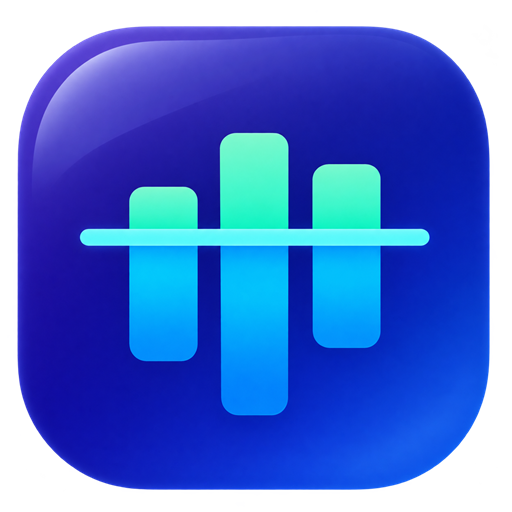
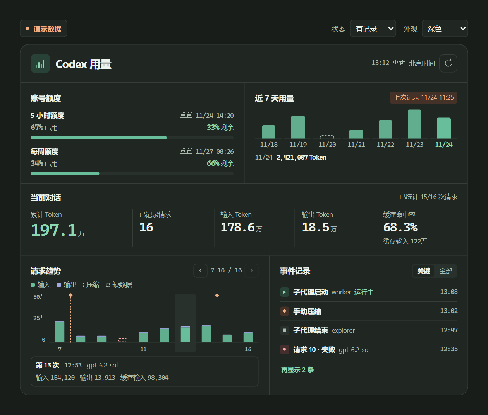
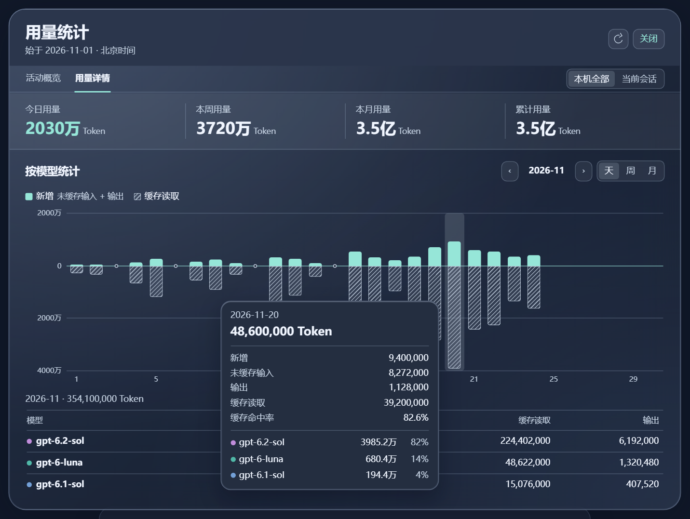
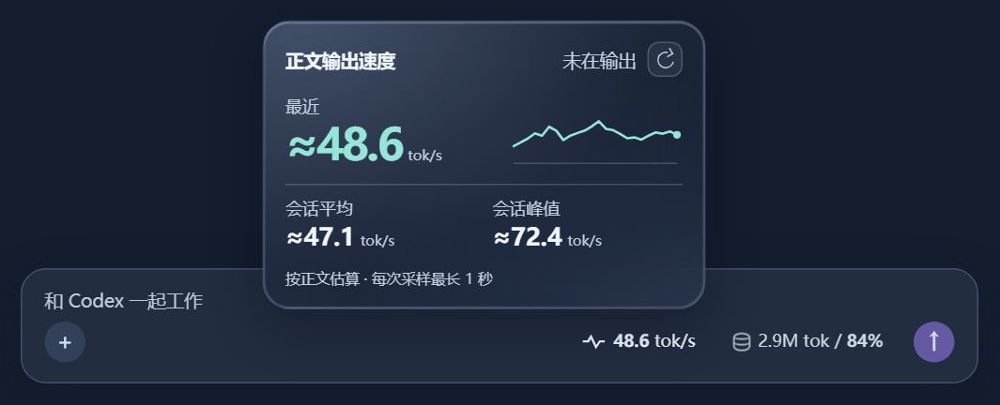

<div align="center">
  
  <h1>Codex 用量看板</h1>
  <p><strong>这条聊天用了多少 Token？在 Codex 里就能看到。</strong></p>
  <p>从整条对话点到单次请求，查输入、输出和缓存，也能顺手看一眼账号额度。</p>
  <p>Windows 桌面端 · 支持离线安装 · <a href="LICENSE">MIT</a></p>
  <p><a href="#界面预览">界面预览</a> · <a href="#安装聊天内看板">快速安装</a> · <a href="#可选的输入区用量速览">Woodfish 速览</a></p>
</div>

> Inspect per-chat token usage, cache hits, request traces, and account limits in Codex for Windows. The optional Woodfish integration shows context-window usage, output speed, and chat usage in the composer.

## 界面预览

截图使用演示数据，点击可以看大图。

[](docs/images/chat-dashboard.png)

**聊天内看板。** 选中一根柱子，就能看到那次请求的 Token 明细。上下文压缩和子代理事件也在旁边，方便对照用量变化。

<table>
  <tr>
    <th>用量冰山图</th>
    <th>输入区测速</th>
  </tr>
  <tr>
    <td valign="top">
      <a href="docs/images/usage-iceberg.png"></a>
      <p>水线上方是新增 Token，斜纹是缓存读取。悬浮查看该时段的分项和模型用量。</p>
    </td>
    <td valign="top">
      <a href="docs/images/composer-speed.png"></a>
      <p>输入区底部直接显示用量和吐字速度。悬浮可以看会话平均、峰值和采样趋势。</p>
    </td>
  </tr>
</table>

## 安装聊天内看板

### Windows x64 离线安装

在 GitHub Releases 下载 `*-windows-x64-offline.zip`，完整解压后双击 `Install.cmd`。电脑需要已安装 Windows 版 Codex 桌面端。包内自带 Node.js 和构建产物，安装插件时无需安装 Node.js、npm 或 Git。

如果电脑已启用 [Woodfish 的 Codex 桌面效果](https://github.com/woodfishhhh/Woodfish-Theme#codex-桌面端)，再双击 `Install-Woodfish.cmd`，即可安装输入区速览。安装完成后可以删除解压目录。更新时解压新版并再次运行相应的安装程序。运行安装程序会启用插件。 [下载离线包](https://github.com/burnerous/codex-context-dashboard/releases/latest)

### 从源码安装

准备 Windows 版 Codex 桌面端、Node.js 24 或更新版本，并确认 PowerShell 能找到 `codex.exe`。

```powershell
git clone https://github.com/burnerous/codex-context-dashboard.git
Set-Location codex-context-dashboard
npm ci
npm run build
.\scripts\install-local.ps1
```

脚本会在 Codex 用户目录注册本地插件源。构建产物包含本机的 Node.js 路径，请在要使用插件的机器上构建。

安装后，在本地聊天发送 **「打开用量看板」**，或用 `@Codex 用量看板` 点名打开。看板绑定到打开它的聊天。如果 Codex 提示「审查钩子」，在设置的「钩子」页核对并启用采集钩子。启用后，新聊天和继续使用的旧聊天都会记录后续请求。

构建生成的 `dist/preview.html` 可以直接在浏览器打开，用演示数据试试浅色、深色、空数据和错误状态。

## 可选的输入区用量速览

聊天内看板可以独立使用。要在输入区底部显示波形、圆柱和环形按钮，先安装聊天内看板，再启用 Woodfish 的 Codex 桌面效果。离线包用户双击 `Install-Woodfish.cmd`。从源码安装时，在项目目录运行下面的命令。 [Woodfish 安装说明](https://github.com/woodfishhhh/Woodfish-Theme#codex-桌面端)

```powershell
.\scripts\install-composer.ps1
```

- **波形按钮**显示当前的估算输出速度，回复结束后留住最近一次采样。测速卡还会显示本轮状态和最近 24 个采样的折线。
- **环形按钮**显示当前聊天的上下文窗口占用。悬停可以查看已用、剩余和窗口上限。数据随 Codex 的上下文用量上报更新，并按会话保留最近一次读数。
- **圆柱按钮**显示当前聊天的累计 Token 和缓存命中率。悬浮还能看到已记录的模型调用次数、账号额度和近 7 天用量。在小卡里点「查看用量统计」，可在本机全部和当前会话之间切换，按天、周或月查看 Token 的新增与缓存读取。冰山图上下共用一个刻度，点柱子可以筛选下方的模型表格。活动热力图也在同一窗口。

悬停打开小卡，点一次固定，再点一次或按 Esc 关闭。小卡右上角的刷新按钮会重读测速样本，或更新本地用量和账号数据。输入区空间紧张时，按钮会收成图标。

「设置 → 外观 → Woodfish 外观 → 用量速览」提供开关和外观参数。统计图上的悬浮提示使用随主题切换的实底。

<details>
<summary>测速和统计口径</summary>

- 速度来自桌面端收到的实时正文片段，采样窗口最长 1 秒。有正文起止时间的短回复也可以按整段估算。切换聊天后，采样仍归入原聊天。桌面保存最近 96 条有采样的聊天，重新打开时恢复读数和折线。
- 小卡打开时每 100 毫秒读取一次本地状态。模型请求结束后更新聊天用量，并尝试刷新账号数据，每分钟最多一次。账号指标暂时取不到时，聊天内看板会保留本窗口上次成功刷新的数据和时间。
- 旧聊天可显示 Codex 上报的「Codex 累计」快照。模型请求明细从采集启用后积累，吐字速度来自后续的流式回复。
- 冰山图的新增量是未缓存输入加输出。今日、本周、本月和累计用量来自本机已采集记录，按北京时间统计，每周从周一开始。

</details>

## 数据与停用

插件从启用采集后开始按工作区记录。请求计数、时间、事件类型和经过散列的标识保存在 Codex 用户目录下的 `codex-context-dashboard/usage.sqlite`。账号额度和每日用量通过本地 Codex App Server 查询，由面板进程缓存。

启用 Woodfish 速览后，插件会为小卡提供最近更新的 96 条聊天的用量汇总和账号指标。需要停止采集时，可以在插件管理中停用「Codex 用量看板」，也可以在「钩子」设置里单独停用采集钩子。

## 开发检查

```powershell
npm test
npm run typecheck
npm run build
npm run build:composer
```

## 许可证

[MIT](LICENSE) · [反馈问题](https://github.com/burnerous/codex-context-dashboard/issues)
